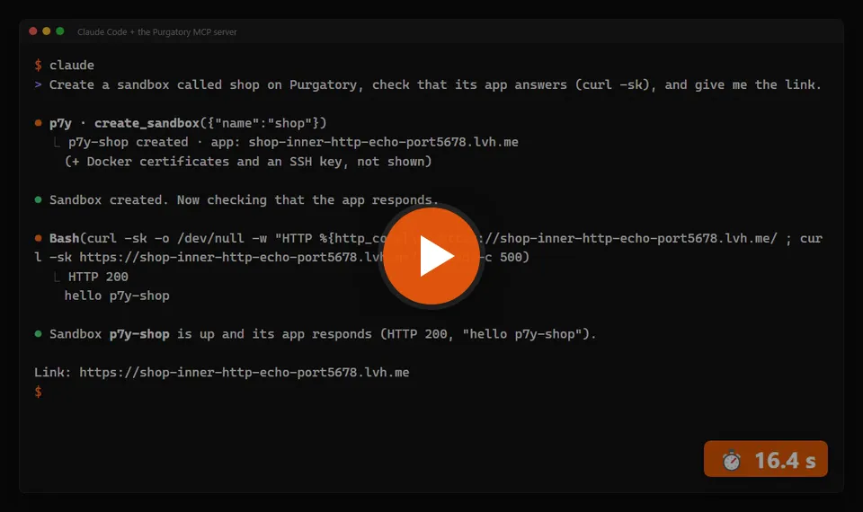
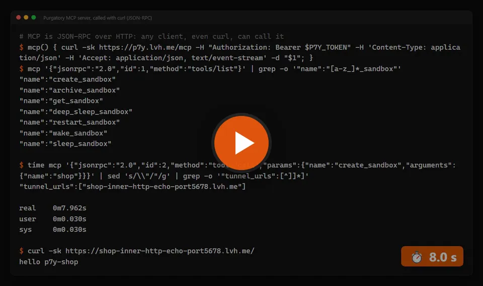

# MCP

[](../media/mcp-agent.mp4)

The same API is an MCP server at `/mcp` (Streamable HTTP): each endpoint is a tool, such as `list_sandboxes`, `create_sandbox`, `wake_sandbox`, `sleep_sandbox`, `get_sandbox` (with its app links), `set_sleep_settings`, and for the sandbox's files `list_sandbox_files`, `read_sandbox_file`, `write_sandbox_file`, `create_sandbox_folder`, `delete_sandbox_file` and `list_sandbox_volumes` (the apps' volumes, whose paths the other file tools take). A tool call runs the endpoint with the caller's token, so it can do exactly what that token can do on the REST API; a token limited to one sandbox stays limited to it, and is offered only the tools it may call (no `create_sandbox`, no token or SSH key management). Only tokens are accepted (not a browser session).

For Claude Code, add it by hand (the [p9m plugin](https://csakaszamok.github.io/p9m/0.16/claude-plugin/index.md) is a deploy skill and does not add it):

```
claude mcp add --transport http p9m https://p9m.example.com/mcp --header "Authorization: Bearer p9m_…"
```

Other clients take the same URL and header, e.g. `{"mcpServers": {"p9m": {"type": "http", "url": "https://p9m.example.com/mcp", "headers": {"Authorization": "Bearer p9m_…"}}}}`. Left out: the log stream (it never ends) and the zip export (a file a tool result cannot carry).

A client that can only start a local process (stdio) can use `scripts/mcp-stdio.mjs` from this repository: it needs only Node.js 18+, no packages, and passes each message to the server's `/mcp` with your token:

```
{"mcpServers": {"p9m": {"command": "node", "args": ["/path/to/p9m/scripts/mcp-stdio.mjs"], "env": {"P9M_URL": "https://p9m.example.com", "P9M_TOKEN": "p9m_…"}}}}
```

Under the hood it is JSON-RPC over HTTP: one `POST /mcp` per call, no session to open first, so even `curl` can call a tool (`tools/list`, then `tools/call` with the tool's `name` and `arguments`):

[](../media/mcp-rpc.mp4)
