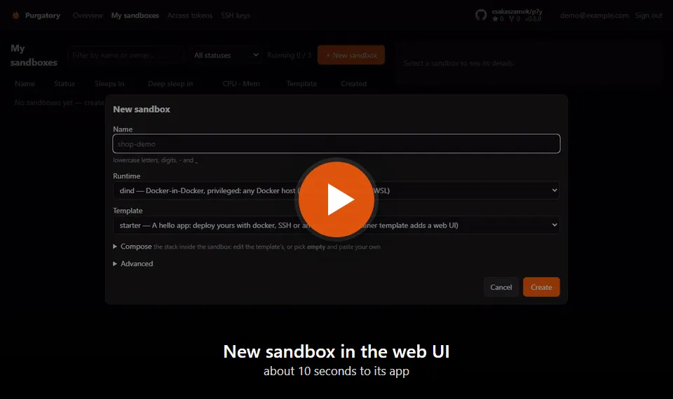
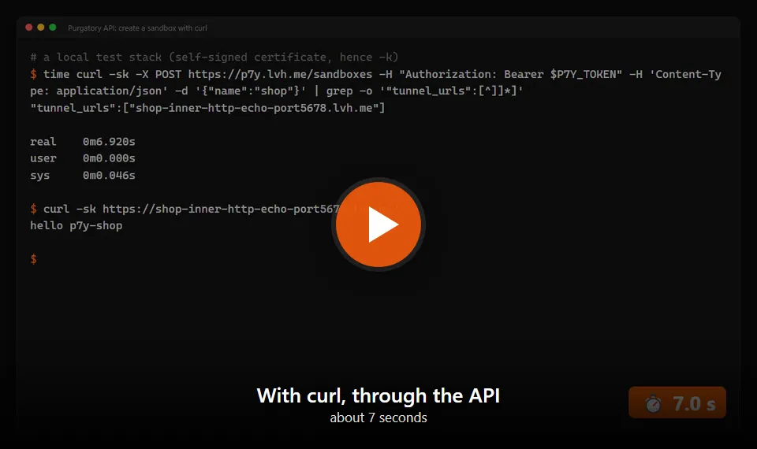
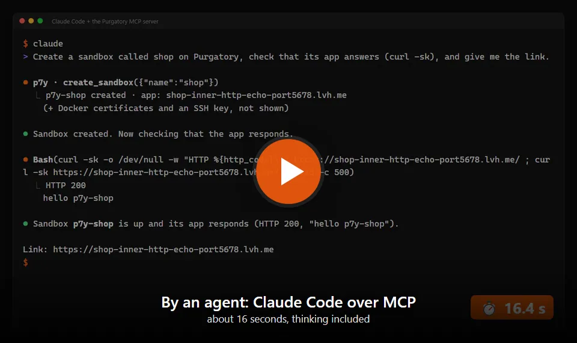
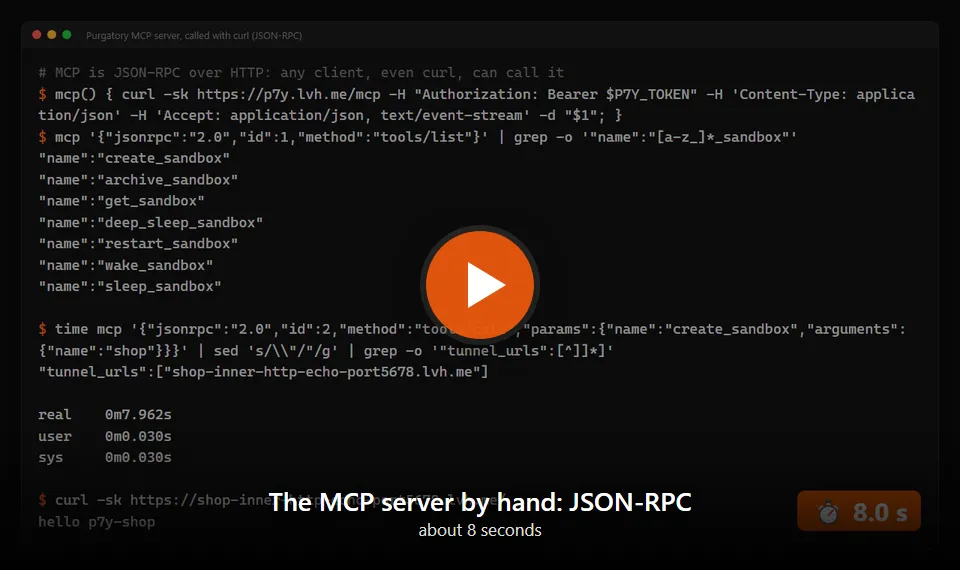

#  Purgatory (p7y)

[](https://p7y-dev.github.io/p7y/latest/) [](https://github.com/p7y-dev/p7y/actions/workflows/ci.yml) [](LICENSE)

> [!NOTE]
> **Early, before 1.0.** It works and is tested (CI on every change, releases with a changelog), but expect rough edges, and breaking changes between minor versions.

**Self-hosted sandboxes for your team and their AI agents: everyone gets their own Docker, every app gets a URL, idle sandboxes sleep.**

**About 10 seconds** from *New sandbox* to your own Docker and a public URL for your app; a sleeping sandbox is back in under 10. (Measured with the images already pulled: the first sandbox on a new server also downloads them.)

<a href="docs/media/demo.gif"></a>

- **Its own Docker daemon** for every sandbox (with a Portainer UI if you want one)
- **A public URL for every app**, and TLS addresses for Postgres, Redis and SSH
- **Sleeps when idle, wakes on the next request**; a delete archives, nothing is lost
- **Made for agents:** tokens limited to one sandbox, an [agent guide](docs/agent-guide.md) and an MCP server

**[Why Purgatory, and how it compares](https://p7y-dev.github.io/p7y/latest/comparison/)** with a laptop, a cloud PaaS, a shared Docker host, Coolify and a VM for everyone · **[How it works](https://p7y-dev.github.io/p7y/latest/architecture.html)**: the components (Docker-in-Docker, frp, Traefik, Sablier), a sandbox's lifecycle and the path of a request

### The same from a script or an agent

All real runs, in real time; press one to watch it.

<table><tr>
<td width="33%"><a href="docs/media/api-curl.gif"></a></td>
<td width="33%"><a href="docs/media/mcp-agent.gif"></a></td>
<td width="33%"><a href="docs/media/mcp-rpc.gif"></a></td>
</tr></table>

With curl through the [API](https://p7y-dev.github.io/p7y/latest/api/), by an agent over the [MCP server](https://p7y-dev.github.io/p7y/latest/mcp/), and the MCP server by hand (JSON-RPC over HTTP, so even curl can call its tools).

## Try it on your laptop

With Docker Desktop, or Docker Engine and the compose plugin on Linux, and ports 80 and 443 free (on Windows, in Git Bash or WSL):

```bash
mkdir p7y && cd p7y
curl -fsSLO https://github.com/p7y-dev/p7y/releases/latest/download/docker-compose.yml
curl -fsSL https://github.com/p7y-dev/p7y/releases/latest/download/setup.sh | bash   # prints the admin password
docker compose up -d
```

Open **http://p7y.lvh.me** (`lvh.me` and all its subdomains point to `127.0.0.1`, so no DNS to set up), sign in as administrator with the password `setup.sh` printed, and press **New sandbox**. The first one takes a minute or two while the images are pulled; after that about 10 seconds. Its app opens at its own `http://<name>-….lvh.me` address.

To remove it: delete the sandboxes in the UI first (each is a compose project of its own, so the next step would leave them running), then `docker compose down -v` in the `p7y` directory, and delete the directory.

## Install

On a Linux host with Docker Engine and the compose plugin, no clone needed ([check the host first](https://p7y-dev.github.io/p7y/latest/install/)):

```bash
mkdir p7y && cd p7y
curl -fsSLO https://github.com/p7y-dev/p7y/releases/latest/download/docker-compose.yml
curl -fsSL https://github.com/p7y-dev/p7y/releases/latest/download/setup.sh | bash -s -- dev.example.com   # .env with your domain and random secrets
docker compose up -d
```

Then sign in at `http://p7y.<HOST_DOMAIN>` (by default `http://p7y.lvh.me`).

## When to use something else

Purgatory is for a team's apps and agents' deployments that should be up at a URL, cheaply, on your own server. For other jobs other tools fit better:

- **Production that must scale and stay up** → a cloud PaaS, or [Coolify](https://coolify.io) / [Dokploy](https://dokploy.com) on your own servers
- **Untrusted code from strangers** → a microVM sandbox such as [E2B](https://e2b.dev) or Docker Sandboxes (until Purgatory has a Kata runtime)
- **Writing code in a cloud IDE** → [Coder](https://coder.com) or GitHub Codespaces
- **An agent running short scripts from an SDK** → E2B or [Daytona](https://daytona.io)

More in [how it compares](https://p7y-dev.github.io/p7y/latest/comparison/).

## Documentation

**[p7y-dev.github.io/p7y](https://p7y-dev.github.io/p7y/latest/)**: [install](https://p7y-dev.github.io/p7y/latest/install/), [configuration](https://p7y-dev.github.io/p7y/latest/configuration/), [let your agent deploy](https://p7y-dev.github.io/p7y/latest/agents/), [MCP](https://p7y-dev.github.io/p7y/latest/mcp/), [API](https://p7y-dev.github.io/p7y/latest/api/), and [`llms-full.txt`](https://p7y-dev.github.io/p7y/latest/llms-full.txt) for agents.

> **Security:** where [sysbox](https://github.com/nestybox/sysbox) is installed, sandboxes run without a privileged container; without it they fall back to the privileged `dind`, which suits a team that trusts each other, not hostile code. On a shared server install sysbox and set `ALLOWED_RUNTIMES=sysbox` ([details](https://p7y-dev.github.io/p7y/latest/security/)).

[Contributing](CONTRIBUTING.md) · [Security issues](SECURITY.md) · [Apache-2.0](LICENSE)

Free to use, also commercially. If you ship Purgatory or a product built on it, keep the [NOTICE](NOTICE) with it, so your users see it is based on Purgatory; the names "Purgatory" and "p7y" are not licensed for another product's name.
