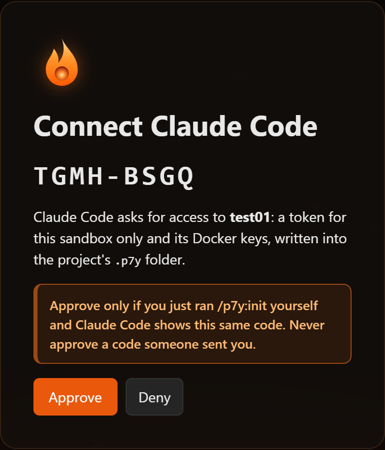

# Put your app online with Claude Code

You have an app on your computer (a website, a dashboard, a small tool) and you want a link to it that works for anyone. Claude Code builds and runs it in your Purgatorium sandbox and gives you that link.

**What you need:** Claude Code (in a terminal, or the **Code** tab of the Claude desktop app), [Docker](https://docs.docker.com/get-docker/) installed on your computer, and a Purgatorium account.

## 1. Make a sandbox

1. Open your Purgatorium address in the browser and sign in.
2. Click **+ New sandbox**, give it a short name (for example `shop`), keep the template and click **Create**. It takes 10–30 seconds.

    { width="560" }

A sandbox is your own small server: your app runs there, not on your computer.

!!! tip "Simple or Advanced"
    The switch at the top right changes how much the screen shows. **Simple** is enough for everything here. If you see no switch, you are in Simple: the server lets only the admin switch.

    { width="420" }

## 2. Install the p9m plugin in Claude Code (once)

1. In Purgatorium, click your sandbox, then **Let your agent deploy…**.

    { width="420" }

    { width="360" }

2. In the window's step **1**, click **Copy** next to each of the two lines, open a terminal (in VS Code: **Terminal → New Terminal**; on Windows also PowerShell, on a Mac the Terminal app), paste them one after the other and press Enter after each:

    ```
    claude plugin marketplace add p9m-team/p9m
    claude plugin install p9m@p9m
    ```

    It installs the plugin for you, in all your projects. It asks for no address and no token.

!!! note "Good to know"
    - `claude` not found? Claude Code is not installed for the terminal: see [Claude Code's setup](https://code.claude.com/docs/en/setup). An *unknown option* means an older Claude Code: run `claude update`.
    - Already in Claude Code? **In Claude Code instead** in the same window shows the same two lines as `/plugin marketplace add p9m-team/p9m` and `/plugin install p9m@p9m`. (The Claude Code panel in VS Code has no `/plugin`: use the terminal.)

You install the plugin once. Each project then gets its sandbox in the next step.

## 3. Connect your project folder to the sandbox (once per folder)

Claude Code needs to know which sandbox belongs to which folder. You tell it once per folder; after that it remembers.

1. Open your app's folder in Claude Code: start `claude` in that folder, or open the folder in VS Code or the desktop app.
2. In Purgatorium, in the **Let your agent deploy…** window, step **2**, click **Copy**. Paste the line into Claude Code and press Enter. It looks like this, with your Purgatorium's address and your sandbox's name:

    ```
    /p9m:init https://p9m.example.com shop
    ```

3. Claude Code answers with a link and a code, for example:

    > Open **https://p9m.example.com/activate?code=TGMH-BSGQ** and approve the code **TGMH-BSGQ**.

4. Open the link in your browser (sign in if Purgatorium asks). The page shows the code and the sandbox. Check that the code is the same one Claude Code printed, then click **Approve**.

    { width="320" }

5. Go back to Claude Code. Within a few seconds it says the folder is connected to the sandbox. That is all.

!!! warning "Approve only your own code"
    Approve a code only if you just ran `/p9m:init` yourself and Claude Code shows that same code. If someone sends you a link like this, do not approve it: whoever started that code would get into your sandbox. Click **Deny** instead.

What happened behind the scenes: Claude Code got a token for this one sandbox and the sandbox's Docker keys, and wrote them into a `.p9m` folder in your project. You never see or copy them. The folder is secret, and it keeps itself out of git on its own: leave it there. The token works for 90 days (then run `/p9m:init` again). You can revoke it in Purgatorium: Advanced → **Access tokens**, where it is named `Claude Code init <date>`.

!!! note "If something goes wrong"
    - **The code ran out:** it works for 10 minutes and only once. Run the same `/p9m:init` line again for a new code.
    - **You clicked Deny by mistake:** run `/p9m:init` again.
    - **The button says *Enable Docker access and approve*:** the sandbox does not let Docker in yet. Click it: the sandbox restarts (about 30 seconds) and Claude Code carries on by itself.
    - **The folder was connected to another sandbox already:** Claude Code asks before it replaces that connection.
    - **A wrong sandbox in the list:** if the line names a sandbox that is not yours, the page lets you pick one of your own sandboxes instead.

## 4. Deploy

In the same folder, say in your own words:

> Deploy this app.

Claude Code wakes the sandbox, builds your app there, starts it and checks that it answers. At the end it gives you a link like `https://shop-web.example.com` (your sandbox's name first). Open it: that is your app, and it works for anyone you send it to.

## 5. Change and update

Changed something? Say:

> Update the app.

The same link shows the new version a few seconds later.

## Good to know

- **Sleep:** when nobody uses the app for a while (30 minutes by default), the sandbox sleeps to free the server. The next visit wakes it in a few seconds: the visitor sees *waking up* and then your app. Nothing is lost.
- **Sleep later:** *let it sleep only after 2 hours without visitors* works too, or set it in Purgatorium: the sandbox → **Details** → **Sleep** → **Change…** (*never* is there as well).
- **It does not answer?** Ask Claude Code *why does my app not answer?*: it reads the app's logs in the sandbox. The usual cause is an app that listens only on `localhost`; Claude Code fixes that.
- **Only for you or your colleagues?** Say *make it visible only to me* (or *only to my colleagues*): Claude Code sets `p9m.access` ([App access](../app-access.md)), and opening the link then asks the visitor to sign in to Purgatorium.
- **Docker is needed on your computer** only for its command line: the build runs in the sandbox.

## More projects

Each folder is tied to one sandbox by its own `.p9m` folder, so different folders can use different sandboxes, even on different Purgatorium servers. For another folder, do step 3 there: in Purgatorium, on that folder's sandbox, **Let your agent deploy…**, copy the `/p9m:init` line and paste it into Claude Code in that folder. The plugin needs no new setup.

To move a folder to another sandbox, run that sandbox's `/p9m:init` line in the folder: Claude Code asks, then replaces the connection.

Used the earlier plugin, which asked for an address and a token? Run `/plugin marketplace update p9m` once, then `/p9m:init` in each project.

More details: [Claude Code plugin](../claude-plugin.md).
