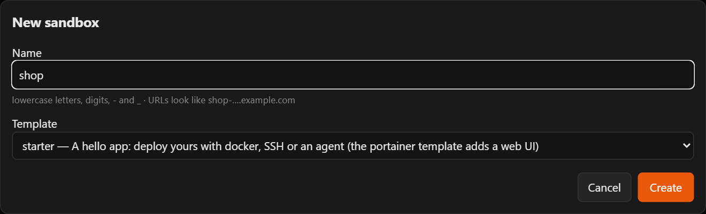
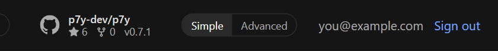
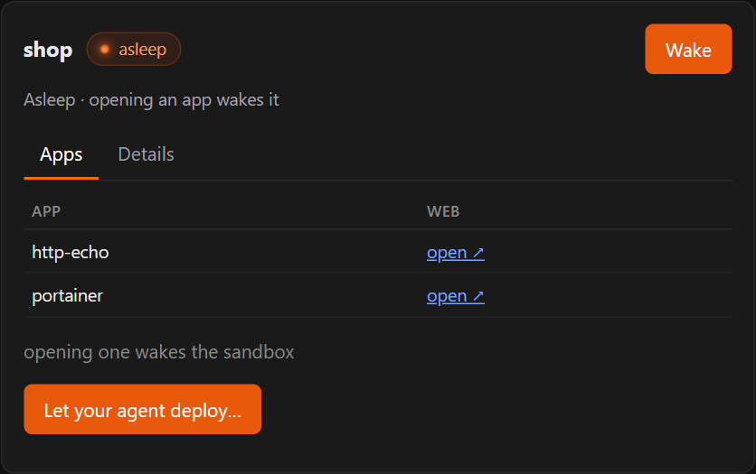

# Put your app online with Claude Code

You have an app on your computer (a website, a dashboard, a small tool) and you want a link to it that works for anyone. Claude Code builds and runs it in your Purgatory sandbox and gives you that link.

**What you need:** Claude Code (in a terminal, or the **Code** tab of the Claude desktop app), [Docker](https://docs.docker.com/get-docker/) installed on your computer, and a Purgatory account.

## 1. Make a sandbox

1. Open your Purgatory address in the browser and sign in.
2. Click **+ New sandbox**, give it a short name (for example `shop`), keep the template and click **Create**. It takes 10–30 seconds.

    { width="560" }

A sandbox is your own small server: your app runs there, not on your computer.

!!! tip "Simple or Advanced"
    The switch at the top right changes how much the screen shows. **Simple** is enough for everything here.

    { width="420" }

## 2. Install the p7y plugin in Claude Code (once)

1. In Purgatory, click your sandbox, then **Let your agent deploy…**.

    { width="420" }

    { width="360" }

2. In Claude Code, run the two commands shown there, one after the other (**Copy** puts each on the clipboard):

    ```
    /plugin marketplace add p7y-dev/p7y
    /plugin install p7y@p7y
    ```

3. When Claude Code asks where to install it, choose **user**: then it works in all your projects.
4. It asks for two things. Both are in the same window in Purgatory:
    - **Purgatory address**: click **Copy** next to *Address* and paste it.
    - **Purgatory access token**: click **Create token**, then **Copy**, and paste it. The token is shown only once; Claude Code keeps it safely, not in a file. It works only for this sandbox.

You do this once. For another sandbox later, see [More projects](#more-projects) below.

## 3. Deploy

Open your app's folder in Claude Code and say, in your own words:

> Deploy this app.

Claude Code wakes the sandbox, builds your app there, starts it and checks that it answers. At the end it gives you a link like `https://shop-web.example.com` (your sandbox's name first). Open it: that is your app, and it works for anyone you send it to.

It also creates a `.p7y` folder in your project: it remembers which sandbox belongs to this project and holds its keys. It is a secret, and it keeps itself out of git on its own; leave it there.

## 4. Change and update

Changed something? Say:

> Update the app.

The same link shows the new version a few seconds later.

## Good to know

- **Sleep:** when nobody uses the app for a while (30 minutes by default), the sandbox sleeps to free the server. The next visit wakes it in a few seconds: the visitor sees *waking up* and then your app. Nothing is lost.
- **Sleep later:** *let it sleep only after 2 hours without visitors* works too, or set it in Purgatory: the sandbox → **Details** → **Sleep** → **Change…** (*never* is there as well).
- **It does not answer?** Ask Claude Code *why does my app not answer?*: it reads the app's logs in the sandbox. The usual cause is an app that listens only on `localhost`; Claude Code fixes that.
- **Docker is needed on your computer** only for its command line: the build runs in the sandbox.

## More projects

The token you created works for one sandbox. For a second project with its own sandbox:

- **Easiest:** in Purgatory, on the other sandbox, **Let your agent deploy…** → **Download**, then in that project say *set up the p7y zip from my Downloads in this project and deploy*. Claude Code puts it in that project's `.p7y` folder and uses it from then on.
- **Many sandboxes:** give the plugin a token for all your sandboxes instead (switch to **Advanced** → **Access tokens** → **+ New token**, then in Claude Code `/plugin` → p7y → configure). Then Claude Code picks the sandbox by the project's name, asks when it is not sure, and creates one when there is none.

More details: [Claude Code plugin](../claude-plugin.md).
