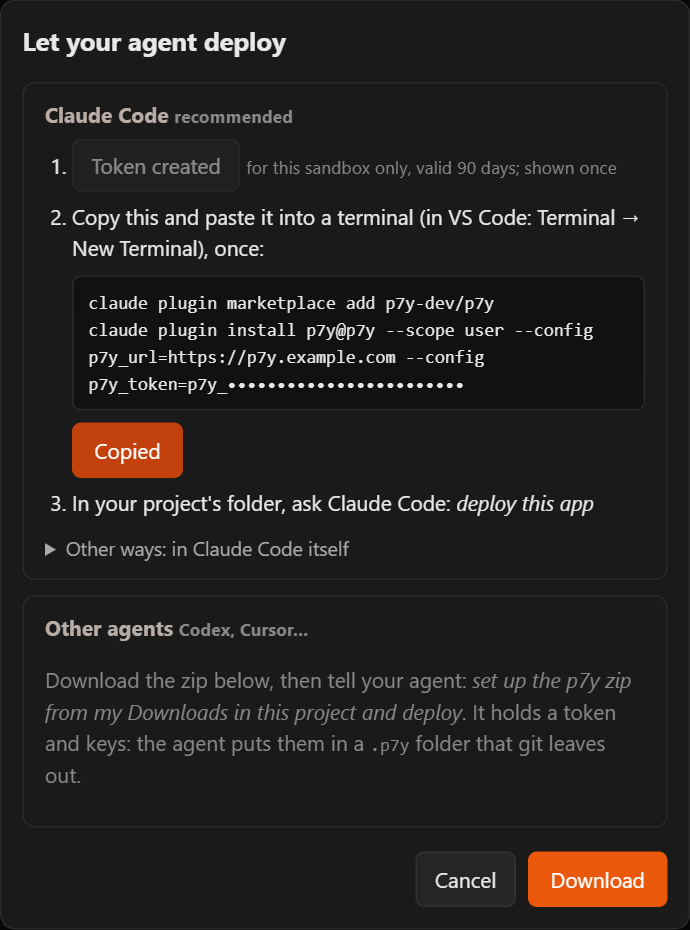

# Put your app online with any agent

For Codex, Cursor, Claude Code without the plugin, or any agent that can run commands on your computer. You download a small zip from Purgatorium; the agent uses it to build and run your app in your sandbox, and gives you its link.

**What you need:** the agent, [Docker](https://docs.docker.com/get-docker/) installed on your computer, and a Purgatorium account with a sandbox (**+ New sandbox** in Purgatorium; see [step 1 of the Claude Code tutorial](claude-code.md#1-make-a-sandbox)).

## 1. Download the zip

In Purgatorium, click your sandbox, then **Let your agent deploy…** → **Download**; in the Advanced view the same window also has **Options** (the token's name and expiry, a zip without the Docker keys, **Copy as .env**). You get `p9m-<sandbox>.zip`.

{ width="360" }

It holds a token for this sandbox and its keys: treat it like a password. Do not email it or commit it.

## 2. Hand it to the agent

Open your app's folder with the agent and say:

> Set up the p9m zip from my Downloads in this project and deploy.

The agent unpacks it into a `.p9m` folder in your project, deletes the zip, builds your app in the sandbox, starts it and gives you its link. The `.p9m` folder keeps itself out of git on its own (it has its own `.gitignore`); leave it there, the agent uses it for every later update.

If the agent does not know what to do, point it to the instructions inside: *read .p9m/README.md and deploy this app to my sandbox*.

## 3. Update

Changed something? *Update the app in my sandbox.* The same link shows the new version.

## Good to know

- The zip's token expires in 90 days (in the Advanced view you can choose 30 days or never). Download a new zip then.
- Lost the zip, or someone else got it? In Purgatorium (Advanced view): the sandbox → **Access** → **Rotate Docker keys…** makes the old keys useless, and **Access tokens** lets you revoke its token.
- Sleep and wake work the same as with Claude Code: see [Good to know](claude-code.md#good-to-know) there.

For agent builders: everything the agent does is in the [agent guide](../agent-guide.md).
